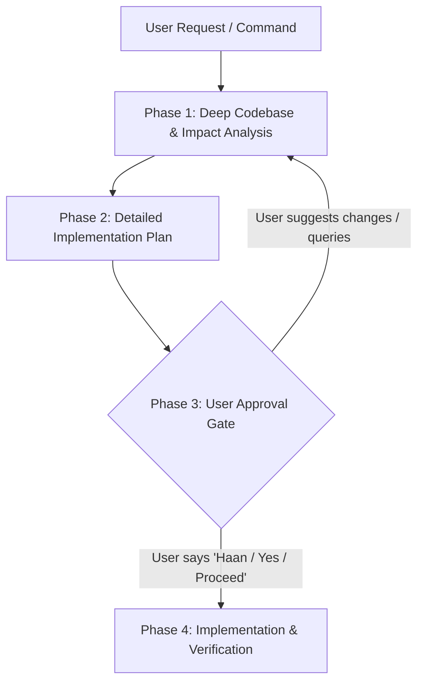

# AGENTS.md — CRMKaro Workflow & Operating Protocol

This file defines the mandatory protocol that the AI Agent MUST strictly adhere to for every user request, command, or feature task.

---

## 🛑 Golden Rule: "Analyze First, Plan Thoroughly, Wait for Approval, Then Implement"

**Never jump straight into editing files or writing code without user confirmation.**
Every task MUST follow the 4-phase lifecycle outlined below.

---

## The 4-Phase Operating Protocol

---

### Phase 1: Deep Analysis (पूरा Analyze करो)
Whenever the user provides any prompt, issue, bug report, or feature request:

1. **Understand Context & Intent:** Clarify the business requirement and user expectations.
2. **Inspect Existing Code & Patterns:**
   - Locate all relevant files (`apps/web`, `apps/api`, `apps/mobile`, `packages/database`, etc.).
   - Review related Prisma models, database relations, and Row Level Security (RLS) policies.
   - Check existing service methods, controllers, schemas (Zod), and frontend pages.
3. **Identify Side Effects & Edge Cases:**
   - Multi-tenancy integrity (Will `organisationId` or RLS be affected?).
   - RBAC permissions (Does this need new or existing permission guards?).
   - Shared packages impacts (`@crmkaro/contracts`, `@crmkaro/database`, `@crmkaro/ui`).
   - Mobile app vs Web app consistency.

---

### Phase 2: Implementation Plan (Detailed Plan बनाओ)
Before touching any code, present a structured, actionable plan to the user containing:

1. **Objective & Scope:** Short summary of what will be achieved.
2. **Files Affected:** Clickable list of files to be created or modified.
3. **Step-by-Step Changes:**
   - Backend changes (Database schema, migrations, DTOs, service logic, controllers).
   - Frontend changes (Web app UI, state management, form validation, responsive layout).
   - Mobile app changes (if applicable).
4. **Verification & Testing Strategy:** How the changes will be tested (build, typecheck, lint, manual flow check).
5. **Approval Request:** A clear concluding prompt asking the user:
   > *"Agar yeh plan theek hai, toh kripya **'Haan' / 'Proceed'** bolein, uske baad hi implementation shuru kiya jayega."*

---

### Phase 3: User Approval Gate (Approval का इंतज़ार करो - STRICT GATE)
* **CRITICAL:** Do **NOT** execute any file edits, deletions, or schema changes during Phases 1 and 2.
* Only read/view files and inspect the system.
* Stop and wait for the user to explicitly say **"Haan" / "Yes" / "Proceed" / "Start"**.
* If the user asks questions or requests changes to the plan, adjust the plan and re-confirm.

---

### Phase 4: Implementation & Verification (Approval मिलने के बाद ही काम शुरू करो)
Once the user confirms with "Haan" / "Proceed":

1. **Execute Changes Step-by-Step:**
   - Follow the approved plan methodically without skipping steps.
   - Maintain coding standards, TypeScript strict typing, and existing architectural patterns.
2. **Verification:**
   - Run typechecks / lint / build to ensure no breaking changes or syntax errors.
   - Verify that the app compiles and runs as expected.
3. **Final Delivery Report:**
   - Summarize what files were modified and what was verified.
   - Provide clear instructions on how the user can test or view the new feature.

---

## 🔒 CRMKaro Architectural Non-Negotiables

Whenever proposing or implementing changes in this project:

1. **Multi-Tenancy & RLS:** All tenant queries must go through `withTenant(...)` or include `organisationId`. Never bypass tenant isolation.
2. **Modular Entitlements:** New modules/routes must be protected with `ServiceEntitlementGuard` and appropriate RBAC permissions (`PermissionGuard`).
3. **Type Safety:** Shared contracts must be defined in `@crmkaro/contracts` or `@crmkaro/database`. Do not use `any`.
4. **Design System:** Use `@crmkaro/ui` and established Tailwind styling. Maintain mobile responsiveness on all views.
5. **Data Safety:** Never execute raw destructive SQL commands (`DROP TABLE`, `TRUNCATE`, unconstrained `DELETE`) without explicit written confirmation.
