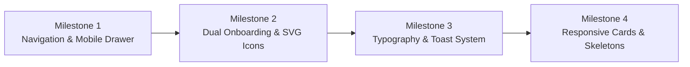

# CRMKaro — UX/UI Improvement & Modernization Plan

> **Document Status:** Planned & Approved for Phased Implementation  
> **Target Applications:** `@crmkaro/web` and `@crmkaro/ui`  
> **Source Ref:** AGENTS.md 4-Phase Operating Protocol

---

## 1. Executive Summary & Objective

CRMKaro web portal aur shared UI layer ka user experience (UX), visual polish, mobile responsiveness, aur conversion funnel ko streamline karna. 

### Key Goals:
1. **Zero Popup Friction:** Naye tabs (`window.open("_blank")`) me CTAs open hone ki samasya ko khatam karke standard Next.js single-page routing dena.
2. **First-Class Mobile Experience:** Header me hamburger navigation drawer add karna aur 768px se niche tables ko responsive card views me convert karna.
3. **Higher Conversion Onboarding:** Direct ₹249 payment paywall ke sath **14-Day Free Trial** option introduce karna.
4. **Perceived Performance & Polish:** Full-screen blocking spinners ke badle progressive in-place skeleton loaders lagana, typography scale ko 14px karna, aur global Toast notifications add karna.

---

## 2. Implementation Milestones

---

### Milestone 1: Navigation, Tab Flow & Mobile Header Menu
* **Primary Scope:** Landing page and header navigation smoothness.
* **Problems Solved:**
  - `apps/web/app/landing/page.tsx` me "Log in" ya "Dashboard" click karne par popup blocker trigger hona ya duplicate tabs banna.
  - Mobile screens (<768px) par navigation links gayab ho jana bina kisi hamburger toggle ke.
* **Detailed File Changes:**
  1. **`apps/web/app/landing/page.tsx`**:
     - Remove `openInNewTab` helper.
     - Integrate Next.js `useRouter` for in-place SPA navigation (`router.push("/login")`, `router.push("/")`).
     - Pass `onRegisterClick` handler to route seamlessly to onboarding or registration.
  2. **`packages/ui/src/LandingPage.tsx`**:
     - Header capsule me mobile menu button (hamburger / close icon) add karna.
     - Mobile navigation drawer render karna (Plans & Pricing, How it Works, Features, FAQ, Login, Register).
  3. **`packages/ui/src/landing.css`**:
     - Drawer animation (`slideDown` / `fadeIn`), backdrop overlay, aur mobile nav items styling.

---

### Milestone 2: Dual Onboarding Flow (Free Trial vs Launch Offer) & Vector SVGs
* **Primary Scope:** Registration conversion rate aur visual brand consistency.
* **Problems Solved:**
  - "Get Started Now" click karte hi seedhe ₹249 Razorpay paywall aana jisse users bounce hote hain.
  - Modal me raw emojis (`📚`, `🏋️`, `💼`) ka use jo Windows/Android par inconsistent dikhte hain.
* **Detailed File Changes:**
  1. **`packages/ui/src/LaunchOfferModal.tsx`**:
     - Top toggle/tab: **"Start 14-Day Free Trial"** vs **"Claim ₹249 Launch Offer"**.
     - Free trial path: Directly completes workspace setup without triggering Razorpay checkout.
     - Paid launch offer path: Razorpay subscription checkout flow triggers as usual.
     - Replace raw emojis in `INDUSTRIES` list with clean inline vector SVGs matching the landing page theme.

---

### Milestone 3: Global Toast Notification System & Base Typography
* **Primary Scope:** Immediate user feedback on micro-interactions and enhanced legibility.
* **Problems Solved:**
  - WhatsApp share link copy karne, attendance mark karne, ya invoice download karne par visual confirmation na aana.
  - Body font `13px` ka modern screens aur mobile devices par dense aur chota lagna.
* **Detailed File Changes:**
  1. **`packages/ui/src/theme.css`**:
     - Base font size ko `13px` se badha kar `14px` karna, line-height `1.5` karna.
     - Form controls aur action buttons ka minimum tap target standard `42px–44px` ensure karna.
  2. **`packages/ui/src/index.tsx`**:
     - Global lightweight Toast component add karna (Success, Info, Error toasts with 3s auto-dismiss).
     - `AppShell` context me expose karna taaki kisi bhi view se `showToast("Message", "success")` call ho sake.

---

### Milestone 4: Skeleton Loaders & Mobile Responsive Table Cards
* **Primary Scope:** In-app workspace experience, perceived speed, and small-screen ergonomics.
* **Problems Solved:**
  - `apps/web/app/page.tsx` me data refresh par poore screen par logo spinner flash hona.
  - Student roster aur transactions table ka mobile screen par cut jana.
* **Detailed File Changes:**
  1. **`apps/web/app/page.tsx`**:
     - Replace full-screen blocking `DashboardLoading()` with modular skeleton cards (metrics cards, activity list skeleton) jo layout shift hone se rokte hain.
  2. **`apps/web/app/students/page.tsx` & `apps/web/app/transactions/page.tsx`**:
     - CSS media query (<768px) ke zariye horizontal table ko adaptive cards list me shift karna.
     - Action buttons (WhatsApp receipt link, Call, Collect fee) ko direct mobile tap-friendly banana.

---

## 3. Files Affected Summary

| File Path | Type | Milestone | Responsibility |
|---|---|---|---|
| `apps/web/app/landing/page.tsx` | Modify | Milestone 1 | SPA navigation without new browser tabs |
| `packages/ui/src/LandingPage.tsx` | Modify | Milestone 1 | Mobile hamburger toggle & drawer navigation |
| `packages/ui/src/landing.css` | Modify | Milestone 1 | Drawer animations & responsive header styling |
| `packages/ui/src/LaunchOfferModal.tsx` | Modify | Milestone 2 | Dual onboarding (Free Trial vs Paid) & SVG icons |
| `packages/ui/src/theme.css` | Modify | Milestone 3 & 4 | 14px typography scale, 44px tap targets, table-to-card styles |
| `packages/ui/src/index.tsx` | Modify | Milestone 3 | Global Toast notification component in AppShell |
| `apps/web/app/page.tsx` | Modify | Milestone 4 | Progressive skeleton loaders for dashboard |
| `apps/web/app/students/page.tsx` | Modify | Milestone 4 | Mobile responsive student roster cards |

---

## 4. Verification & QA Checklist

- [ ] **SPA Navigation:** Verify clicking "Log in" or "Get Started" does NOT open a new tab on Chrome, Edge, or Safari.
- [ ] **Mobile Hamburger Drawer:** Open mobile viewport (<768px), verify hamburger icon opens drawer smoothly and links scroll to correct sections.
- [ ] **Dual Onboarding Flow:** Verify "Start 14-Day Free Trial" successfully creates workspace without Razorpay prompt; verify "Launch Offer" triggers Razorpay checkout.
- [ ] **Cross-Platform SVG Consistency:** Verify all industry selector icons render sharply as SVGs on Windows, macOS, Android, and iOS.
- [ ] **Toast Feedback:** Verify toast appears upon copying receipt links or marking attendance.
- [ ] **Mobile Table Ergonomics:** Verify student roster on 375px viewport displays card view with direct WhatsApp/Call buttons.
- [ ] **TypeScript Strict Build:** Run `pnpm --filter @crmkaro/web typecheck` and `pnpm --filter @crmkaro/ui typecheck` with 0 errors.

